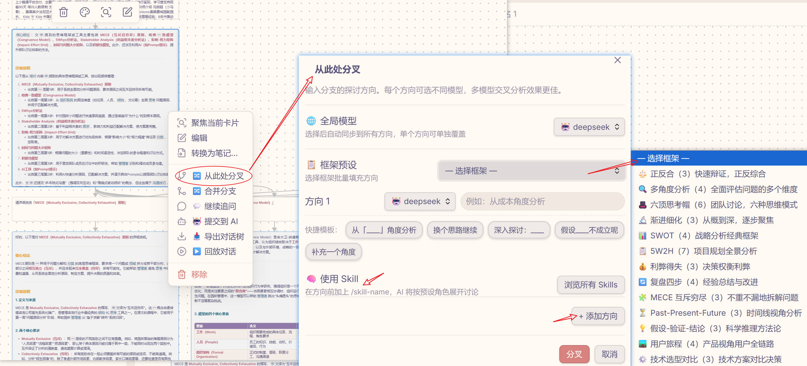
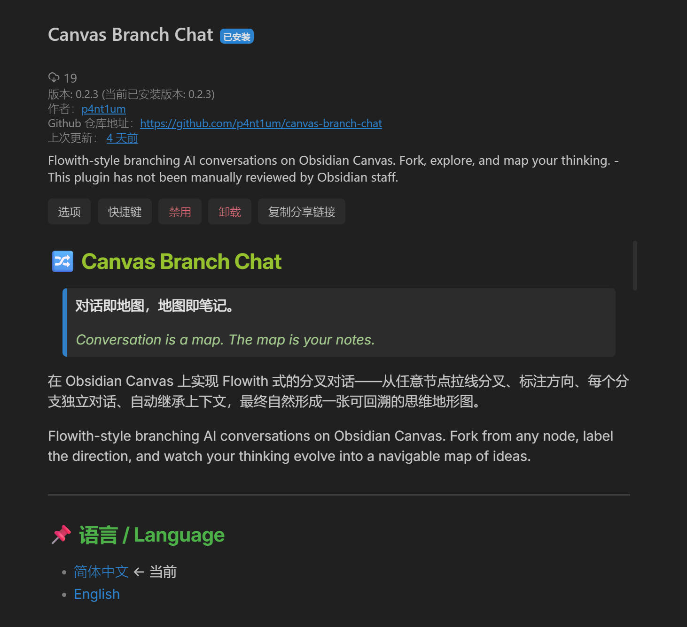

# 🔀 Canvas Branch Chat

> **对话即地图，地图即笔记。**
>
> *Conversation is a map. The map is your notes.*

在 Obsidian Canvas 上实现 Flowith 式的分叉对话——从任意节点拉线分叉、标注方向、每个分支独立对话、自动继承上下文，最终自然形成一张可回溯的思维地形图。

Flowith-style branching AI conversations on Obsidian Canvas. Fork from any node, label the direction, and watch your thinking evolve into a navigable map of ideas.

---

## 📸 预览 / Screenshots



*多方向分叉对话 + 框架预设 + 模型选择 — 中文界面*



*语言设置：跟随系统 / 简体中文 / English*

---

## 📌 语言 / Language

- [简体中文](#简体中文) ← 当前
- [English](#english)

---

**最新版本**: v0.3.4 | **更新**: 2026-07-27 | **发布**: [GitHub Releases](https://github.com/p4nt1um/canvas-branch-chat/releases)

---

## 简体中文

### 这是什么？

这不是"又一个 AI 聊天插件"——Obsidian 已经有 Text Generator、Copilot 等。这个插件的真正价值是**把对话变成可浏览的思维地图**：

- 每次分叉都是在地图上开一条新路
- 最终你得到的不只是一段对话，而是一张完整的思考地形图
- 可以回溯、可以导出、可以嵌入你的笔记体系

### 核心功能

| 功能 | 说明 | 状态 |
|------|------|:---:|
| 🔀 从节点分叉 | 右键任意对话节点 → 输入方向 → 创建新的 AI 对话分支 | ✅ |
| 🔀 多方向批量分叉 | 一次输入多个方向，并行生成多条分支 | ✅ |
| 🏷️ 方向标注 | 分叉时输入方向（如"从成本角度分析"），标注在连接线上 | ✅ |
| 🔗 上下文继承 | 沿直系祖先链自动收集对话历史，新分支自带完整上下文 | ✅ |
| 💬 继续追问 | 在当前分支链上追加对话，直线延续 | ✅ |
| 🤖 单次问答 | 不带历史上下文，快速问一句 | ✅ |
| 🎨 多模型配置 | 每个模型独立配置：别名、Provider、Base URL、颜色、图标、系统提示词、Temperature | ✅ |
| 🏷️ 指定模型分叉 | 右键 → 指定模型分叉，不同模型不同视角 | ✅ |
| 🔬 连通性测试 | 配置时一键测试 API 连通性，远端获取模型列表 | ✅ |
| 👁️ 节点视觉区分 | 用户节点灰色、AI 节点用模型配置色，一眼区分谁说的 | ✅ |
| 🌈 分支颜色编码 | 不同分支自动分配不同颜色，一眼看出分叉结构 | ✅ |
| 📤 导出 Markdown | 将整棵对话树导出为带层级缩进、双链引用的 Markdown 文件 | ✅ |
| 📝 节点自动命名 | AI 回答完成后自动写入摘要元数据，Canvas 上不用打开就能看到梗概 | ✅ |
| ⚡ 流式刷新 | token 级流式更新到 Canvas 节点，实时看到 AI 输出 | ✅ |
| 🏷️ 快捷模板 | 分叉弹窗中可点击的模板 chips，一键插入常用方向 | ✅ |
| 🔀 分支合并 | 多分支合并为总结节点 | ✅ |
| ▶️ 回放对话 | 按时间线/广度/深度回放整棵对话树 | ✅ |
| 🌐 多语言 | 简体中文 / English，跟随系统自动切换 | ✅ |
| 🔑 跨平台 API Key | 四层降级策略，支持 .env 文件和直接输入 | ✅ |
| 🌐 BASE_URL 自动匹配 | 读取 API Key 环境变量时自动匹配 BASE_URL | ✅ |

### 效果示意

> 📸 参见上方[预览截图](#-预览--screenshots)

```
                    ┌──[成本角度]──→ [AI回答: 成本...] ──→ [追问] ──→ ...
[问题: 这个方案如何?] ──┼──[安全角度]──→ [AI回答: 安全...] ──→ [追问] ──→ ...
                    └──[换个思路]──→ [AI回答: 换个...] ──→ [追问] ──→ ...
```

### 安装

#### 方式一：手动安装

1. 下载 [最新 Release](https://github.com/p4nt1um/canvas-branch-chat/releases/latest)
2. 解压得到 `main.js`、`manifest.json`、`styles.css`
3. 放到你的 Obsidian vault 插件目录：
   ```
   <你的vault>/.obsidian/plugins/canvas-branch-chat/
   ```
4. Obsidian → 设置 → 第三方插件 → 启用「Canvas Branch Chat」

#### 方式二：从源码构建

```bash
git clone https://github.com/p4nt1um/canvas-branch-chat.git
cd canvas-branch-chat
npm install
npm run build
```

将生成的 `main.js`、`manifest.json`、`styles.css` 复制到插件目录。

### 配置

#### API Key 配置（安全方案）

插件支持**四种 API Key 配置方式**，按优先级从高到低：

```
1. 设置面板直接输入（最高优先级）
   ↓
2. 插件目录 .env 文件
   ↓
3. Vault 根 .env 文件
   ↓
4. 系统环境变量（最低优先级）
```

**方式一：设置面板直接输入**（推荐，最简单）

1. 设置页 → 模型配置
2. 找到「API Key」输入框
3. 直接填入你的密钥（密码框显示，存储在 `data.json`）

**方式二：使用 .env 文件**

创建 `.env` 文件（选择以下任意位置）：

- 插件目录：`.obsidian/plugins/canvas-branch-chat/.env`
- Vault 根：`你的vault/.env`

文件内容：
```bash
DEEPSEEK_API_KEY=你的密钥
DEEPSEEK_BASE_URL=https://api.deepseek.com/v1  # 可选
```

**方式三：系统环境变量**（适合开发者）

- **macOS / Linux**：编辑 `~/.bashrc` 或 `~/.zshrc`，添加：
  ```bash
  export DEEPSEEK_API_KEY=你的密钥
  ```
  保存后执行 `source ~/.bashrc`。
- **Windows**：搜索「环境变量」→ 系统属性 → 新建用户变量。

设置完成后**重启 Obsidian**，确保配置被加载。

**BASE_URL 自动匹配**

如果使用 `.env` 文件配置 `DEEPSEEK_API_KEY`，插件会自动读取同文件中的 `DEEPSEEK_BASE_URL` 并覆盖设置面板的 Base URL 配置。

**安全提示**：
- ✅ 方式一（直接输入）存储在本地 `data.json`，仅自己可见
- ✅ 方式二（.env 文件）不会提交到版本控制
- ✅ 方式三（环境变量）最安全，不写入任何文件
- ❌ 不要将密钥提交到 Git 仓库

#### 模型配置

1. 设置页 → 添加模型
2. 填写配置：
   - **别名**：显示名（如「分析师」）
   - **Provider**：deepseek / openai / custom
   - **Base URL**：API endpoint
   - **API Key**：选择方式（直接输入 / 环境变量名）
3. 点击「测试连接」验证连通性并获取可用模型列表
4. 选择模型，配置：
   - **颜色**：节点边框/背景色
   - **图标**：节点小标识（🔬🔴🔵）
   - **系统提示词**：模型人设
   - **Temperature**：创造性 vs 严谨

支持任意 OpenAI 兼容 API（DeepSeek、OpenAI、Ollama 本地模型等）。

### 使用

1. 在 Obsidian 中打开一个 Canvas
2. 创建文本节点，输入你的问题
3. 右键节点 → 选择操作：
   - **🔀 从此处分叉** — 输入方向（支持多个），AI 从该角度回答
   - **🏷️ 指定模型分叉** — 选择不同模型/角色进行分叉
   - **💬 继续追问** — 在当前分支链上继续对话
   - **🤖 提交到 AI** — 单次问答，不带历史
   - **📥 导出对话树** — 将整棵对话树导出为 Markdown
4. AI 回答实时流式显示在 Canvas 节点中

### 技术栈

- **平台**: Obsidian Plugin API (Canvas)
- **语言**: TypeScript
- **构建**: esbuild
- **API 协议**: OpenAI 兼容（支持 DeepSeek、OpenAI 等任意兼容端点）
- **基于**: [HinxCorporation/obsidian-canvas-ai](https://github.com/HinxCorporation/obsidian-canvas-ai) (MIT)

---

## English

### What is this?

This is not "yet another AI chat plugin" — Obsidian already has Text Generator and Copilot. The real value of this plugin is **turning conversations into navigable thinking maps**:

- Each fork opens a new path on the map
- What you get is not just a conversation, but a complete topography of your thinking
- Traceable, exportable, and embeddable in your note system

### Core Features

| Feature | Description | Status |
|---------|-------------|:------:|
| 🔀 Branch from node | Right-click any node → enter direction → create a new AI branch | ✅ |
| 🔀 Multi-direction batch fork | Enter multiple directions at once, generate branches in parallel | ✅ |
| 🏷️ Direction labels | Label each fork with its exploration direction (e.g., "cost analysis") | ✅ |
| 🔗 Context inheritance | Automatically collect conversation history along the ancestor chain | ✅ |
| 💬 Continue chat | Append dialogue on the current branch chain | ✅ |
| 🤖 Quick ask | Single Q&A without history context | ✅ |
| 🎨 Multi-model config | Per-model config: alias, provider, base URL, color, icon, system prompt, temperature | ✅ |
| 🏷️ Choose model to fork | Right-click → pick a specific model/role to branch with | ✅ |
| 🔬 Connectivity test | One-click API test + fetch remote model list | ✅ |
| 👁️ Visual differentiation | User nodes grey, AI nodes use model's color — instantly distinguishable | ✅ |
| 🌈 Branch color coding | Each branch gets a unique color from the palette | ✅ |
| 📤 Export Markdown | Export the entire conversation tree as hierarchical Markdown with wiki links | ✅ |
| 📝 Auto node naming | AI responses auto-write summary metadata for easy scanning on Canvas | ✅ |
| ⚡ Streaming | Token-level streaming updates to Canvas nodes in real time | ✅ |
| 🏷️ Quick templates | Clickable template chips in the branch dialog for common directions | ✅ |
| 🔀 Branch merging | Combine multiple branches into a summary node | ✅ |
| ▶️ Replay | Step through the conversation tree chronologically | ✅ |
| 🌐 i18n | 简体中文 / English, auto-detect system locale | ✅ |
| 🔑 Cross-platform API Key | Four-tier fallback strategy, supports .env files and direct input | ✅ |
| 🌐 BASE_URL auto-match | Auto-match BASE_URL when reading API Key env variable | ✅ |

### Example

> 📸 See [screenshots above](#-预览--screenshots)

```
                       ┌──[Cost]──→ [AI: Cost analysis...] ──→ [Follow-up] ──→ ...
[Q: How about this?] ──┼──[Security]──→ [AI: Security...] ──→ [Follow-up] ──→ ...
                       └──[Alt approach]──→ [AI: Alternative...] ──→ [Follow-up] ──→ ...
```

### Installation

#### Option 1: Manual install

1. Download the [latest release](https://github.com/p4nt1um/canvas-branch-chat/releases/latest)
2. Extract `main.js`, `manifest.json`, `styles.css`
3. Place them in your vault's plugin directory:
   ```
   <your-vault>/.obsidian/plugins/canvas-branch-chat/
   ```
4. Obsidian → Settings → Community plugins → Enable "Canvas Branch Chat"

#### Option 2: Build from source

```bash
git clone https://github.com/p4nt1um/canvas-branch-chat.git
cd canvas-branch-chat
npm install
npm run build
```

Copy the generated `main.js`, `manifest.json`, `styles.css` to the plugin directory.

### Configuration

#### API Key Configuration (Secure)

The plugin supports **four API Key configuration methods** (high to low priority):

```
1. Direct input in settings (highest priority)
   ↓
2. Plugin directory .env file
   ↓
3. Vault root .env file
   ↓
4. System environment variables (lowest priority)
```

**Method 1: Direct Input in Settings** (Recommended, Simplest)

1. Settings → Model configuration
2. Find "API Key" input field
3. Enter your key directly (password field, stored in `data.json`)

**Method 2: Use .env File**

Create `.env` file (choose any of these locations):

- Plugin directory: `.obsidian/plugins/canvas-branch-chat/.env`
- Vault root: `your-vault/.env`

File content:
```bash
DEEPSEEK_API_KEY=your-key-here
DEEPSEEK_BASE_URL=https://api.deepseek.com/v1  # optional
```

**Method 3: System Environment Variables** (For developers)

- **macOS / Linux**: Edit `~/.bashrc` or `~/.zshrc`:
  ```bash
  export DEEPSEEK_API_KEY=your-key-here
  ```
  Then run `source ~/.bashrc`.
- **Windows**: Search "Environment Variables" → System Properties → New user variable.

**Restart Obsidian** after configuration.

**BASE_URL Auto-Match**

When using `.env` file with `DEEPSEEK_API_KEY`, the plugin automatically reads `DEEPSEEK_BASE_URL` from the same file and overrides the Base URL in settings.

**Security Tips**:
- ✅ Method 1 (direct input) stores in local `data.json`, visible only to you
- ✅ Method 2 (.env file) won't be committed to version control
- ✅ Method 3 (env vars) is most secure, not written to any file
- ❌ Never commit keys to Git repository

#### Model Configuration

1. Settings → Add Model
2. Fill in:
   - **Alias**: Display name (e.g., "Analyst")
   - **Provider**: deepseek / openai / custom
   - **Base URL**: API endpoint
   - **API Key**: Choose method (direct input / env var name)
3. Click "Test Connection" to verify and fetch available models
4. Select model, configure:
   - **Color**: Node border/background
   - **Icon**: Small node identifier (🔬🔴🔵)
   - **System Prompt**: Model persona
   - **Temperature**: Creative vs strict

Supports any OpenAI-compatible API (DeepSeek, OpenAI, Ollama local models, etc.).

### Usage

1. Open a Canvas in Obsidian
2. Create a text node and type your question
3. Right-click the node → choose an action:
   - **🔀 Branch from here** — Enter direction(s), AI responds from that angle
   - **🏷️ Fork with model** — Choose a specific model/role to branch with
   - **💬 Continue chat** — Continue the conversation on the current chain
   - **🤖 Ask AI** — Single Q&A, no history
   - **📥 Export conversation tree** — Export as Markdown
4. AI responses stream into Canvas nodes in real time

### Tech Stack

- **Platform**: Obsidian Plugin API (Canvas)
- **Language**: TypeScript
- **Build**: esbuild
- **API Protocol**: OpenAI-compatible (supports DeepSeek, OpenAI, or any compatible endpoint)
- **Based on**: [HinxCorporation/obsidian-canvas-ai](https://github.com/HinxCorporation/obsidian-canvas-ai) (MIT)

---

## License

MIT

## Roadmap

See [PLAN.md](./PLAN.md) for the full development roadmap.

### P2 (Next)

- Context pruning — selectively exclude ancestor nodes when forking
- Smart follow-up — AI suggests follow-up questions
- Skill scanner integration

### P3 (Future)

- Industry scenario templates (product review, academic debate, security audit)
- MCP tool calls from branch nodes
- Knowledge base RAG integration
- Export as interactive HTML for sharing

## Contributing

Issues and PRs welcome. This is a community project built on top of the MIT-licensed [obsidian-canvas-ai](https://github.com/HinxCorporation/obsidian-canvas-ai).

---

<p align="center">
  <sub>Built with 🧚‍♀️ by Zhang Bin</sub>
</p>
